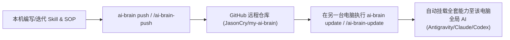

# 日常 AI 协同“在流经验沉淀”标准操作规程 (In-flow Experience Distillation SOP)

## 1. 规程目的与价值
在日常高频的 AI 协作中，知识与经验最容易在一次性对话关闭后随风消散。本 SOP 确立了**“免记长 Prompt、极简短语唤醒、AI 自动萃取五层模型、跨设备无缝同步”**的标准操作范式，实现个人与团队认知资产的复利式积累。

---

## 2. 跨机器协同工作流与同步机制

本套体系依托 `my-ai-brain` 资产库实现“一处沉淀，多机共享”：

### 多设备使用指南：
1. **在新电脑或另一台工作机上**：
   - 首次克隆并初始化：`git clone git@github.com:JasonCry/my-ai-brain.git ~/Projects/my-ai-brain && ~/Projects/my-ai-brain/bin/install-global.sh`（或通过 `/ai-brain-init`）。
   - 日常接收更新：只需在任意 AI 会话中输入 `/ai-brain-update` 或终端执行 `ai-brain update`。
2. **在日常会话中**：
   - 完成深度任务后，直接输入 `萃取经验` 或 `结案沉淀`，AI 会自动按五层模型提炼资产。

---

## 3. 标准三步作业循环

### 步骤 1：事前（框架先导，拒绝盲目发散）
遇到复杂新课题，先让 AI 输出分析维度与决策树，注入你的独家约束（如业务阶段、特定流程门禁）。

### 步骤 2：事中（交代原因，固化判断）
在给 AI 纠偏时，多说半句“为什么”（如：“不要选方案 A，因为在跨组交付时容易产生模糊地带”）。这些判定依据是萃取的关键养料。

### 步骤 3：事后（短语唤醒，极简落库）
会话达成闭环后，敲入 2~4 个字的触发词：
> **`萃取经验`** / **`结案沉淀`** / **`提炼SOP`** / **`/distill`**

AI 自动输出包含以下内容的 Markdown 资产卡：
- **场景与边界**（生效条件 vs 破例边界）
- **核心分析框架**（3~4 步方法论结构）
- **踩坑与禁忌清单 (Taboos)**（直觉误区与不能踩的红线）
- **决策取舍法则 (Trade-offs)**（多目标冲突时的坚定选择）
- **最小可用工具包 (Actionable Checklist)**

---

## 4. 审核与编译机制
- 萃取出的卡片默认放入 `00_Inbox/变更草案/` 或作为草案留存。
- 定期（如双周或月度）由 Agent 或人工扫描草案，将沉淀下的心法与规程合入正式知识库或更新至全局 `AGENTS.md`，使 AI 幕僚越来越懂你。
